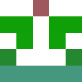
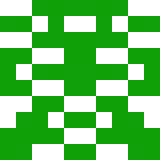

# identicon-generator-go

| Symmetric | Mosaic | Rings |
| :-: | :-: | :-: |
|  |  |  |

This is a Go identicon generator. Give it a seed and it draws an avatar. Feed it the same seed twice and you get the same picture. The three images above all use `alice@example.com`; only the style changes.

Everything here runs on the Go standard library, with no other dependencies.

## Install

```sh
go get github.com/M1chlCZ/identicon-generator-go@v0.3.0
```

## Library

`Render` takes a string seed, checks the configuration and returns an error if something is wrong:

```go
package main

import (
	"log"

	identicon "github.com/M1chlCZ/identicon-generator-go"
)

func main() {
	config := identicon.DefaultConfig()
	config.Width = 800
	config.Height = 800
	config.GridSize = 7

	img, err := identicon.Render("alice@example.com", config)
	if err != nil {
		log.Fatal(err)
	}
	if err := identicon.SaveImage(img, "alice.png"); err != nil {
		log.Fatal(err)
	}
}
```

Seeds are hashed with SHA-256, so a seed renders the same on every machine. `WritePNG` writes to any `io.Writer` when you don't want a file:

```go
var buffer bytes.Buffer
if err := identicon.WritePNG(&buffer, img); err != nil {
	log.Fatal(err)
}
```

### Legacy API

`GenerateIdenticon` and `GenerateIdenticonWithConfig` are still there. They keep the original integer seeds, MD5 hash and pixel output:

```go
img := identicon.GenerateIdenticon(123)
identicon.SaveImage(img, "legacy.png")
```

These two panic on an invalid configuration. New code should use `Render`.

### Configuration

| Field | Default | Meaning |
| --- | --- | --- |
| `Width` | `420` | Image width in pixels |
| `Height` | `420` | Image height in pixels |
| `GridSize` | `5` | Grid dimension, at least 1 |
| `Grayscale` | `false` | Draw grey cells only |
| `Style` | `StyleSymmetric` | `symmetric`, `mosaic` or `rings` |

`Config.Validate` wants positive dimensions, a positive grid size and at least one pixel per grid cell.

### Styles

`StyleSymmetric` is the classic mirrored grid. `StyleMosaic` uses a denser mirrored grid and three colours. `StyleRings` draws concentric rings:

```go
config := identicon.DefaultConfig()
config.Style = identicon.StyleRings
img, err := identicon.Render("alice@example.com", config)
```

When the style comes from a configuration file or a flag, `identicon.ParseStyle("mosaic")` turns the name into a `Style`.

## CLI

The command writes one identicon or a whole batch:

```sh
go run ./cmd/identicon -seed alice@example.com -out avatars
go run ./cmd/identicon -count 20 -start 1 -out avatars -width 500 -grid 6 -style mosaic
```

| Flag | Default | Meaning |
| --- | --- | --- |
| `-seed` | empty | Render one identicon from a string seed |
| `-count`, `-c` | `150` | Number of images in batch mode |
| `-start` | `1` | First integer seed in batch mode |
| `-out` | `.` | Output directory |
| `-prefix` | `identicon` | File name prefix |
| `-style` | `symmetric` | `symmetric`, `mosaic` or `rings` |
| `-width`, `-w` | `420` | Image width in pixels |
| `-height` | `420` | Image height in pixels |
| `-grid`, `-g` | `5` | Grid dimension |
| `-gray` | `false` | Draw grey images |
| `-version` | `false` | Print the version |

Batches are named `identicon_001.png`, `identicon_002.png`, and so on. One seed writes `identicon.png` unless you pass `-prefix`.

## Development

```sh
go test -race ./...
go vet ./...
go build ./...
```

The roadmap covers batch input, SVG output, a terminal UI, an HTTP avatar service and release binaries.

## Support

If this project helps you, you can support its development.

[](https://ko-fi.com/m1chl)
<a href="https://buymeacoffee.com/xdujifyzvt"></a>

## Licence

MIT License. See [LICENSE](LICENSE).
